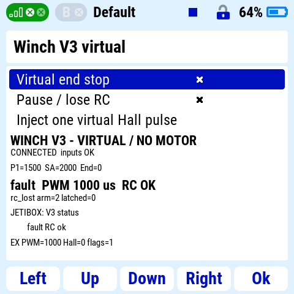

# Tatsächlicher JETI-Studio-Test

Datum: **2026-10-07**, Windows, Europe/Berlin. Ergänzung auf Branch
`codex/seilwinde-v3`, ausgehend von `268eb95742b33f32764a765f5658dbbe0d86f442`.
Firmware und Steuerungskern sind gegenüber Implementierungscommit
`a79fe70e7641ac7b78674e0c9d6521c5e028e396` unverändert. Neu sind die
Lua-/TCP-Testbrücke, der Hosthelfer und ihre Regressionstests.

**Ergebnis: virtuelle Senderbedienung zum echten portablen V3-Kern bestanden.**
Die geprüfte Verbindung lautet:

`DC/DS-24II Lua → Loopback-TCP → Python-EX-Bus-Master → C++ Application/Core`

Der C++-Helfer verarbeitet die erzeugten Kanal-, Menü- und Telemetriepakete mit
denselben Parser-/Steuerquellen wie die Firmware. Python validiert die Antworten
unabhängig mit CRC16 und EX-CRC8. Lua zeigt deren Text und Werte an. Es gibt
keinen physischen Motorpfad und keine RA4M1-Peripherie in diesem Prozess.

## Download, Installation und Start

Von der [offiziellen Herstellerseite](https://www.jetimodel.com/support/jeti-studio/jeti-studio.html)
wurde **JETI Studio 1.2.3, Windows 64 Bit** heruntergeladen und installiert.
Die lokale Installerdatei liegt unter
`.build/jeti-studio/JETI-Studio-1.2.3-windows-x64.exe`, Größe **71.475.381 Byte**,
SHA256 **`A1B4DE7F45CF314B4EE33657075EE07485590641759788587AD4569DE9DBAB9C`**.
Installer und Herstellerdateien bleiben ignorierte lokale Artefakte.

Tatsächlich ausgeführte unbeaufsichtigte Installation nach Prüfung von
Installerhilfe und Paketliste:

```powershell
$winchInstaller = 'entwicklung/seilwinde_v3/.build/jeti-studio/JETI-Studio-1.2.3-windows-x64.exe'
$winchInstallRoot = Join-Path (Get-Location).Path 'entwicklung/seilwinde_v3/.build/jeti-studio/app'
& $winchInstaller --root $winchInstallRoot --accept-licenses --confirm-command --reject-messages install com.jetimodel.jetistudio
```

Installation: Exit 0. Studio-GUI und `dc-sim2.exe` wurden tatsächlich gestartet.
Die Senderkonsole meldet **JETI DS-24 II, emulator=1, version=6.04**, **Lua 5.3**,
**integer-max=2147483647**, **LuaSocket 3.0-rc1** und eine leere COM-Portliste.
Ein eigenes virtuelles Modell `A` wurde angelegt und die App aktiviert.

Der erste Emulatorstart schaltete nach der Einschaltabfrage wieder ab.
Nach Beenden wurde in der neu erzeugten
`%LOCALAPPDATA%\JETI-Studio\Emulator\Config.jsn` ausschließlich `fast-Start`
von 0 auf 1 geändert. Danach blieb der Sender eingeschaltet. Die tatsächlich
verwendete Einrichtung steht in der [Lua-Anleitung](../simulator/jeti/README.md).

## GUI-Szenarien und beobachtete Ergebnisse

Die Bedienung erfolgte am laufenden Senderemulator, mit P1/SA/SB/SC als
direkten Eingängen. Modellmischer/Servoausgänge O1–O4 wurden nicht getestet.
PWM-Angaben sind **Host-Sollwerte**, keine elektrischen Messungen.

| GUI-Aktion | Ergebnis | Tatsächlicher Nachweis |
| --- | --- | --- |
| Neue Lua-App laden, Neutral senden | **bestanden** | CONNECTED, idle/1000 µs, RC frisch; nach stabiler Neutralphase arm=3 |
| SA=+1 RUN | **bestanden** | SLOW-Rampe bis 1280 µs; unbekannte Position führt konservativ zu SLOW |
| SA=0 Mitte | **bestanden** | SLOW/1280 µs läuft autonom weiter |
| SD=+1 Endschalter | **bestanden** | idle/1000 µs, Grund end_switch, end_latched=1; SD=0 startet nicht erneut |
| SA=−1 LEARN, keine Hall-Pulse, dann Mitte | **bestanden** | LEARN bei 1000 µs, anschließend learn_rejected; kein neuer Weg gelernt |
| Zweiter RUN, dann SE=+1 Verbindungsabbruch | **bestanden** | Host läuft weiter und liefert fault/1000 µs, rc_lost, RC alt; Lua zeigt PAUSED/STALE und den letzten gecachten Wert |
| SE=0 bei weiterhin SA=+1 RUN | **bestanden** | GUI fault/1000 µs, RC OK, rc_lost, arm=2; kein Wiederanlauf |
| SG positive Flanke und Formular-F4 | **bestanden** | Tatsächlicher JETIBOX-Text wechselt zu Rope metres und über F4 zu FAST max us; EX-Werte bleiben sichtbar |
| Finale Lua-Datei neu laden | **bestanden** | Konsole bestätigt die oben genannten Versionen, Verbindung erneut hergestellt; fault/1000 µs bleibt erhalten |

Der LCD-Export zeigt gehaltenes RUN (`SA=2000`), wieder frische RC-Daten und
weiterhin STOP nach Verbindungsrückkehr:



Das lokale, begrenzte JSONL-Protokoll
`artifacts/jeti-gui-session.jsonl` enthält die tatsächlichen Eingangswertwechsel
und Zustände. Ausgewählte Host-Modellzeiten dieser Sitzung:

| Modellzeit ms | Beobachtung |
| --- | --- |
| 554880 | erster RUN erreicht SLOW/1280 µs |
| 581099 | Endschalter: idle/1000 µs, end_latched=1 |
| 616673 | LEARN, 1000 µs |
| 635442 | learn_rejected, idle/1000 µs |
| 645779 | zweiter RUN erreicht SLOW/1280 µs |
| 668296 | TCP-Verbindung getrennt |
| 668358 | fault/1000 µs, rc_lost, RC alt |
| 680836 | wieder frische RC-Daten, fault/1000 µs bleibt |

Diese Abstände sind Host-Poll-/Modellzeiten, **keine gemessenen MCU- oder
ESC-Reaktionszeiten**. Das Rohlog enthält auch anfängliche fehlerhafte
Verbindungsversuche und einen separaten TCP-Diagnoseabruf ohne RC-Proben.

## Gefundene Fehler und erneute Prüfung

Der erste Lua-Antwortparser meldete BAD REPLY: Die obere uint32-Grenze als
Integerliteral `4294967295` überlief im tatsächlich verwendeten 32-Bit-Lua-Build.
Die Konsole bestätigt den Integerhöchstwert 2147483647. Der Guard verwendet jetzt
die explizite Fließkommagrenze `4294967296.0`; virtuelle Hall-/Sequenzzähler
bleiben im positiven Integerbereich. Nach Kopieren/Reload bestanden alle oben
genannten Verbindungsszenarien. Der erlaubte EX-Hexbereich wurde ebenfalls an
die begrenzte Protokollantwort angepasst.

Ein lokaler Gesamtprüfaufruf ohne LLVM-DLL-Verzeichnis im PATH scheiterte beim
Start der Test-EXE. Wiederholung mit dem dokumentierten PATH bestand vollständig;
kein Fehler im Steuerungskern. Ein Sandbox-Linkerzugriff erforderte Ausführung
außerhalb der Dateisandbox. Der neue Bridge-Test bekommt im Gesamtbuild jetzt
explizit den gewählten Compiler und Sanitizer-Modus.

## Reproduzierbare Hostprüfungen

Vom Repository-Root, Clang/GCC mit C++11 und Python 3.13:

```powershell
python entwicklung/seilwinde_v3/tests/test_jeti_bridge.py --sanitize
python entwicklung/seilwinde_v3/simulator/jeti_bridge.py --log entwicklung/seilwinde_v3/artifacts/jeti-gui-session.jsonl
```

Der zweite Befehl bleibt als Server aktiv; Ctrl+C beendet ihn. Zum erneuten
Gesamttest auf dem verwendeten Windows-Rechner:

```powershell
$env:PATH = (Resolve-Path -LiteralPath 'entwicklung/seilwinde_v3/.build/tools/llvm-mingw-20261006-ucrt-x86_64/bin').Path + ';' + $env:PATH
python entwicklung/seilwinde_v3/build.py native --compiler entwicklung/seilwinde_v3/.build/tools/llvm-mingw-20261006-ucrt-x86_64/bin/clang++.exe --sanitize
```

**Bestanden:** fünf native C++-Suiten, unabhängige Referenztelegramme,
14 deterministische Replays, R4-Adapter-Spies, Loggerparser sowie neuer Bridge-Test
mit strengen Warnungen, ASan und UBSan. Bridge-Regressionen prüfen Boot mit RUN,
Neutral/neue Flanke, autonomes Weiterlaufen, Endschalter, alle 15 EX-Messwert-IDs,
echte Menüantworten, unabhängige CRC-Prüfung, fortgesetzte Zeit bei getrenntem
Client, doppelte Proben ohne RC-Auffrischung, Rückkehr mit gehaltenem RUN,
begrenzte ungültige TCP-Eingaben und asynchrone Evidenzaufzeichnung.
Lokaler Gesamtlog: `artifacts/native-jeti-final.log` (generiert, ignoriert).

## Nicht ausgeführte Prüfungen und Grenzen

- **Nicht ausführbar:** native Empfänger-/EX-Sensorinjektion des Emulators,
  Funktransport, native JETIBOX über Funk, R4/UART/PWM/Flash und Lastprüfungen.
  Es wurde kein dokumentierter frei verwendbarer nativer EX-Bus-Endpunkt des
  Senderemulators nachgewiesen. Lua-Werte werden nicht in `system.getSensors()`
  eingespeist; der Sender verwendet hier unsere Anzeige und TCP-Brücke.
- **Nicht ausgeführt in der GUI:** vollständiges Lernen mit Hall-Pulsen,
  Speicherübernahme, Sprachwarnung und Auswahl des ganzseitigen Telemetriewidgets.
  Getestet wurde die App-Formansicht; Lernen/Persistenz sind separat nativ geprüft.
- Die Live-Bridge hat eine uint32-Mikrosekunden-Sitzungsgrenze von etwa 71 Minuten
  und beendet sich bei einem Host-Zeitsprung über 1 Sekunde. Neue Sitzung vor der
  Grenze starten. Die Firmwareüberlaufprüfungen sind davon getrennte Hosttests.
- Lua-I/O und Puffer sind begrenzt; Betriebssystem/Lua-Scheduler sind keine
  Echtzeitgarantie. Die [JETI Lua API 1.5](https://github.com/JETImodel/Lua-Apps/blob/master/Doc/JETI%20DCDS_Lua_API_1.5.pdf)
  dokumentiert Emulator-LuaSocket und Sender-Form-/Eingangs-APIs. Die elektrische
  [Werkbankabnahme](../hardware/README.md) bleibt offen.
